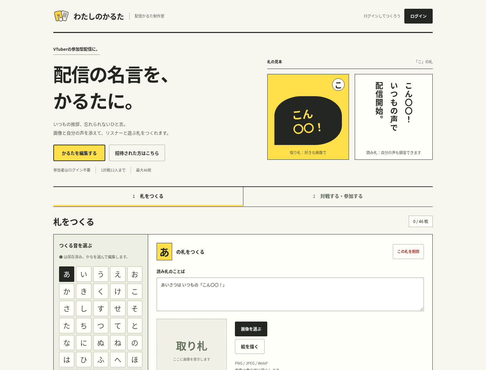
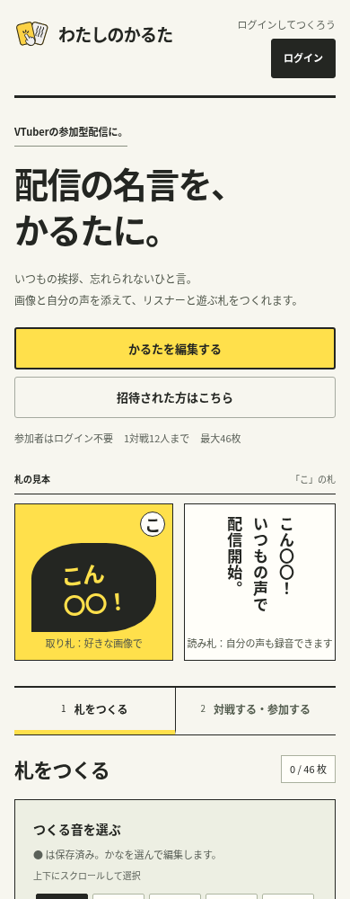
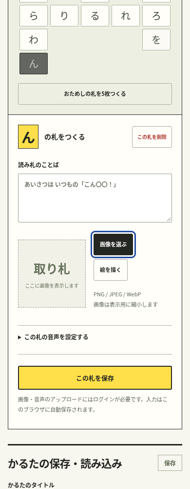

# 配信かるた制作室のデザインレビュー

## 目的と判断方法

VTuberが配信の挨拶・名言・画像・録音を札にして、リスナーを招待する用途を画面から伝える。実装者による2回のレビューとブラウザ測定を行った。「AIが作ったように見えるか」は主観を含むため、独立した第三者評価や、すべての人がそう評価しないことの保証ではない。

## 1回目：構成と表現の変更

以前の紫のグラデーション、大きな角丸、星やハート、浮遊するカード、英語の飾り見出しを整理した。紙色・墨色・黄色と罫線を基調に、実際の取り札と縦書きの読み札を並べた。「配信の名言を、かるたに。」という見出しと編集・参加の導線を中心にした。

編集画面は五十音表と編集欄を一つの作業台として構成した。や行・わ行には実際の空きを設け、「ゆ・よ・を・ん」を探せる配置にした。招待URLでは参加画面を優先する既存の挙動を維持した。

## 2回目：読みやすさと操作性の修正

スマートフォンの補足文と札のキャプションを拡大した。タブの黄色は選択位置を示す下線に絞り、主要ボタンとの強弱をつけた。ファイル選択はキーボードで到達できるようにし、フォーカス枠を表示した。

ブラウザでの測定結果は [audit.json](design/audit.json) に保存した。

- 画面幅320・390・768・1440pxで横方向のはみ出しなし。
- 初期編集画面で測定対象とした表示中の操作要素は幅・高さとも44px以上。
- 主要テキスト10箇所のコントラスト比は最小5.47:1。
- ヒーローなど測定対象の背景にグラデーションなし。
- 「ゆ・よ・を・ん」の配置・選択、ファイル入力へのキーボードフォーカスを確認。
- TypeScript、Clerkと対戦のブラウザテスト、SEOテストが成功。

これらは表示・操作の測定であり、独自性のスコアではない。外部認証画面を含む全状態のアクセシビリティ認証でもない。スクリーンショットは外部通信を制御したローカル環境で取得し、フォントはシステムの代替書体を含む。公開環境へのデプロイ確認は含まない。

## 最終画面

### PC

### スマートフォン

